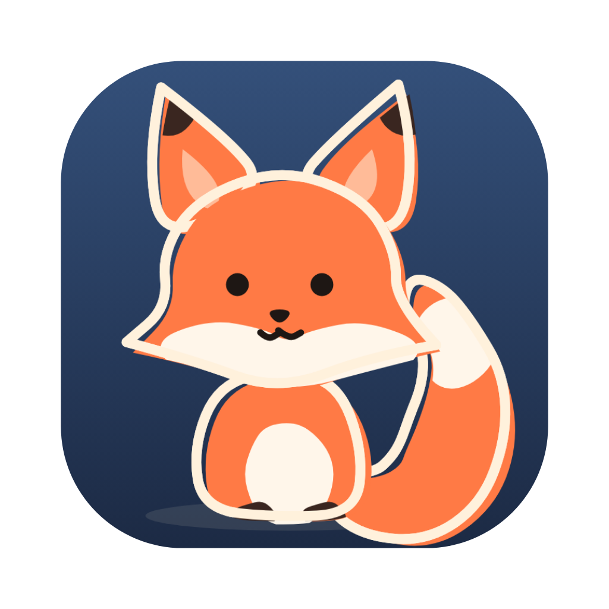

# Fox Buddy



A hand-drawn fox who lives in a corner of your Mac's screen and keeps an eye on Claude for you,
Clippy-style. He works while Claude works, waves when it needs you, celebrates when it finishes,
and you can chat with him.

**[Get him at justinfuchs85.github.io/fox-buddy](https://justinfuchs85.github.io/fox-buddy/)**: a signed,
notarized download for Apple silicon and Intel Macs (macOS 12 or later), or `brew install --cask
justinfuchs85/fox-buddy/fox-buddy`. His chat needs Claude Pro or Max; he installs Claude Code himself.

## What he does

- **Shows what Claude is doing**, across Claude Code, the Claude desktop app (Chat and Cowork) and
  claude.ai in Chrome or Safari. While Claude works he rotates through three acts: accountant (green
  visor, adding machine), typewriter, and mad scientist. Small counters show how many sessions are
  working, waiting on you, or done.
- **Talks in a speech bubble**: "Running `npm test`", "needs your permission to use Bash", "done: …".
  **Show me** brings that session forward: the terminal, the browser tab or the Claude app.
- **Chats and helps**: press **⌥ Space** from any app (Setup › Keyboard Shortcut to change it), or
  double-click him, to ask a question; the mic button dictates. **Drop files on him** (PDFs, documents,
  screenshots) to ask about them: he can open just those, in that chat. Dropped text lands in the message
  box, ready for "tighten this". He reads **Reminders, Notes and your Shortcuts list** too, and adds a
  reminder, makes a note or runs a shortcut only after you approve it. He can find files by name in Desktop,
  Documents and Downloads (and open them if you let him), read your Gmail and Google Calendar, search
  the web, check your iPhone activity summary, and use tools of your own that you plug in. He changes your calendar or writes a Gmail draft
  only after you click **Yes, do it** on a card showing exactly what he'll do, and never sends email. A
  gate checks every tool call he makes, whatever your own Claude Code settings allow. Bigger jobs go to Claude Desktop with
  **Open in Claude**. Details: [His tools](tools/foxbuddy/README.md#his-tools).
- **Remembers what you tell him**: "remember that…" saves a note once you OK it, a few questions the
  first time he opens set his name and how chatty he is, and **What He Knows About You** shows it all in
  his chat. A **morning check-in** gives you today's meetings and the email that needs you, and
  **email alerts** ("tell me when anything from Jane comes in") make him hold up a letter when matching mail
  arrives: he checks every 15 minutes while you're at your Mac (right-click › Email Alerts).
- **Wakes up when you come over**: he dozes when nothing's going on. Click him, or rest your pointer on
  him for a second, and he yawns, rubs his eyes and waves; while you type in his bubble, he watches.
- **Gags**: once he's awake, click him for one of 14 (pounce, tail chase, zoomies, floss, dab, dubstep
  and more), or pick one from the right-click menu.
- **Keeps himself up to date**: he tells you in his chat when there's a new version, and one click
  installs it. He handles company networks that inspect traffic, tells you plainly when something's
  not set up, and **Report a Problem…** opens a GitHub issue showing you exactly what's in it first.
- **Extras**: goes from orange toward red as you near your Claude usage limits, holds a ringing clock
  before meetings, holds up a letter for a Slack VIP, and sleeps at night. He's silent.

## Get him

**Website:** https://justinfuchs85.github.io/fox-buddy/

**Download (easiest):** grab the latest `.dmg` from the [Releases page](https://github.com/justinfuchs85/fox-buddy/releases),
open it and drag Fox Buddy to Applications. The first time he opens, he offers to set himself up: a small
background helper (in `~/.desk-buddy`), Claude Code's hooks, and, if they're missing, Claude Code itself and
your sign-in to Claude (in your browser; no Terminal). You need a Claude Pro or Max plan. Right-click him ›
**Setup** to connect Gmail and Calendar, and for the Claude-app watcher, the browser extension and updates.

**Homebrew:**

```bash
brew tap justinfuchs85/fox-buddy https://github.com/justinfuchs85/fox-buddy
brew install --cask justinfuchs85/fox-buddy/fox-buddy
```

(The full name tells Homebrew 6 you trust this one cask; it doesn't install from third-party taps otherwise.)

**Updates:** he checks once a day and tells you in his chat when there's a new version. Click **Update**
and he installs it and restarts, keeping your settings.

## Set him up from the code

You need a Mac with the Xcode command line tools (`xcode-select --install`), Python 3 and Claude Code.

```bash
git clone https://github.com/justinfuchs85/fox-buddy.git
cd fox-buddy
zsh tools/foxbuddy/build.sh        # builds ~/Applications/Fox Buddy.app and opens it
tools/install_bridge.sh            # the bridge (and the Claude-app watcher), as login items
                                   #   add --no-appwatch if you use claude.ai in a browser instead
python3 tools/install_hooks.py     # Claude Code's hooks and status line
```

Using claude.ai in a browser? Load the extension in [`tools/browserwatch`](tools/browserwatch/README.md).
More on the app, the menu and the chat: [`tools/foxbuddy/README.md`](tools/foxbuddy/README.md).

To update later: `git pull && zsh tools/foxbuddy/build.sh`.

## What's in here

| Path | What it is |
|---|---|
| `tools/foxbuddy` | The Mac app: window, menu, speech bubble, chat, his tools, and the socket the bridge talks to |
| `characters/fox` | The fox: drawn entirely in code by his own rig |
| `tools/buddy_bridge.py` | The bridge: turns Claude's activity into his moods (a login item, on `127.0.0.1:47823`) |
| `tools/install_hooks.py`, `tools/statusline.sh` | Claude Code hooks and the usage status line |
| `tools/appwatch` | Reads Chat and Cowork activity from the Claude desktop app (needs Accessibility) |
| `tools/browserwatch` | Chrome and Safari extension for claude.ai |
| `tests` | The bridge's tests: `python3 -m unittest discover -s tests` |
| `.github/workflows/release.yml`, `RELEASING.md` | The signed, notarized download, built on GitHub |

The bridge and the app only listen on `127.0.0.1`, the app's own window makes no internet requests,
and the browser extension sends labels like "Stop response", never message text. His chats go to
Claude through Claude Code, with whatever he looks up for you: see
[what leaves your Mac](tools/foxbuddy/README.md#his-tools).

## Credit

Fox Buddy grew out of [desk-buddy](https://github.com/csimpkins22/desk-buddy), based on
[Joe Bentham's](https://github.com/joebentham/desk-buddy) Lump. The bridge, hooks and watchers
started there. Fox Buddy has none of Lump's art: the fox, his drawings and the app are new. MIT
licensed: see `LICENSE`.
